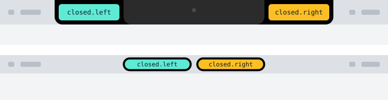
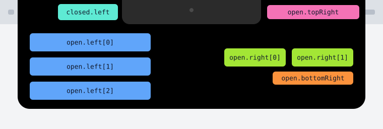

# Island

The island sits in the center of the macOS menu bar. A plugin can put a little information on it, such as the time left in a focus session. Hovering over the island expands it; clicking it opens the plugin's page.

- Requires the `island` permission; see [Permissions](permissions.md).
- The island exists only on macOS. On other operating systems, `island.show` still succeeds but displays nothing.
- The plugin chooses which component goes in each position. Hindsight draws the island; the plugin cannot put its own HTML on it.

## Island positions

### Closed



The upper example shows a screen with a notch; the lower one shows a screen without one.

| Position | Allowed content |
|---|---|
| `closed.left` | One [`icon`](island/icon.md), [`timer`](island/timer.md), [`ring`](island/ring.md), or [`text`](island/text.md) |
| `closed.right` | Same as `closed.left` |

- At least one side must have content. An empty side does not extend outward.
- Each side fits its content, up to 90 pixels wide. A side with only an icon is circular.
- The closed island is only as tall as the menu bar, so `text` here must be small and cannot have `sub`.

### Open



| Position | Allowed content |
|---|---|
| `closed.left` | Remains in place, as when closed |
| `open.topRight` | A small [`text`](island/text.md) segment. It appears to the right of the notch, or immediately after `closed.left` on a screen without a notch. When present, `closed.right` is hidden; otherwise `closed.right` remains in place |
| `open.left` | Up to three components, stacked vertically and aligned left |
| `open.right` | Up to two components, arranged in one row and aligned right |
| `open.bottomRight` | A small [`text`](island/text.md) segment below `open.right`, aligned right |

- The open island fits its content, up to 520 pixels wide.
- `open` is optional. Without it, hovering does not expand the island; clicking still opens the plugin's page.

## Example

A focus plugin starts a 25-minute focus session:

```json
{
  "closed": {
    "left": { "type": "icon", "name": "Code", "color": "#a78bfa" },
    "right": { "type": "timer", "start": "2026-10-21T10:00:00+09:00", "end": "2026-10-21T10:25:00+09:00", "color": "#fb923c" }
  },
  "open": {
    "topRight": { "type": "text", "text": [{ "text": "Working", "bold": true }, { "text": " · Code", "dim": true }] },
    "left": [
      { "type": "text", "text": [{ "text": "2:40", "bold": true }], "sub": "/ 6:00", "size": "large" },
      { "type": "cells", "colors": ["#a78bfa", "#a78bfa", "#f87171", null, null], "current": 2, "columns": 15 }
    ],
    "right": [
      { "type": "timer", "start": "2026-10-21T10:00:00+09:00", "end": "2026-10-21T10:25:00+09:00", "color": "#fb923c" },
      { "type": "button", "id": "pause", "icon": "Pause" }
    ],
    "bottomRight": { "type": "text", "text": ["Distracted ", { "text": "3", "color": "#f87171", "bold": true }, " times"] }
  }
}
```

Compare it with the two illustrations above:

- Closed: the category icon is on the left, and the countdown is on the right.
- Open: “Working · Code” appears at the top right; today's time and a row of cells are on the left; the countdown and pause button are on the right; the number of distractions is below the button.

Show or remove the content:

```js
hindsight.call("island.show", content);
hindsight.call("island.hide");
```

## Components

Each component has its own page describing its fields, allowed positions, and limits.

| Component | Description | Allowed when closed? |
|---|---|---|
| [`icon`](island/icon.md) | Icon | Yes |
| [`text`](island/text.md) | One line of text | Yes, small only |
| [`timer`](island/timer.md) | Countdown | Yes |
| [`ring`](island/ring.md) | Progress ring | Yes |
| [`cells`](island/cells.md) | Cells | No |
| [`button`](island/button.md) | Button | No |

All components use the same color rules:

- Colors must be `#rrggbb`.
- Hindsight brightens colors that are too dark to read on the black background. A plugin can use category colors directly.

## Errors

- If content exceeds a limit or violates a rule, `island.show` fails instead of silently truncating it. Each component page lists its limits.
- Error messages begin with `invalid input: ` and then identify the failing position or component, for example `invalid input: open.left[1]: text is 9 wide, at most 8`.

## When several plugins use the island

- The last plugin to call `island.show` takes the island. After it calls `island.hide`, the previous plugin's content returns if that plugin has not removed it.
- A plugin's content is removed when the plugin is disabled or uninstalled, or its background script is stopped.
- Clicking the island opens the page of the plugin currently occupying it, in a separate window.

## Version compatibility

- The island is available from Hindsight 0.10.0.
- Unknown components are skipped without an error. A new plugin using a new component on an older Hindsight simply shows less content. If both closed sides are skipped, the call fails because the island would be empty.
- Skipped components still count toward the limits for `open.left` and `open.right`. The same content either passes or fails validation on both old and new versions.
- Unknown fields are ignored.
