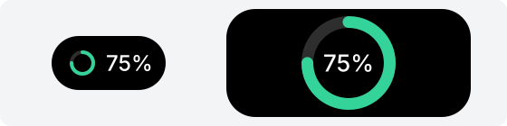

# ring: Progress ring



The illustration shows the closed island on the left and the open island on the right, both with `value` set to 0.75.

```json
{ "type": "ring", "value": 0.75, "text": "75%", "color": "#34d399" }
```

| Field | Required? | Description |
|---|---|---|
| `value` | Yes | Progress from 0 to 1; 1 draws a complete circle |
| `text` | No | Appears to the right of the ring when closed, or in its center when open |
| `color` | No | Ring color as `#rrggbb`; defaults to white |

## Allowed positions

| Position | Appearance |
|---|---|
| `closed.left`, `closed.right` | 14-pixel ring |
| `open.left`, `open.right` | 52-pixel ring |

## Length and value limits

Calls that violate these limits fail:

- `value` must be between 0 and 1.
- `text` must be nonempty and at most 6 display units wide, as calculated in [text](text.md). It cannot contain control characters such as a newline.
