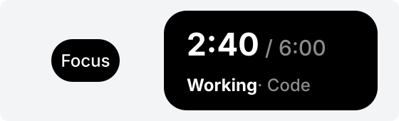

# text: One line of text



The illustration shows small text on the closed island on the left. On the open island on the right, the upper example is large text with `sub` and the lower one is small text split into segments.

```json
{ "type": "text", "text": "Focus" }
```

```json
{ "type": "text", "text": [{ "text": "2:40", "bold": true }], "sub": "/ 6:00", "size": "large" }
```

```json
{ "type": "text", "text": [{ "text": "Working", "bold": true }, { "text": " · Code", "dim": true }] }
```

| Field | Required? | Description |
|---|---|---|
| `text` | Yes | A string or an array of segments |
| `sub` | No | Small gray text following the main text; must be a string |
| `size` | No | `"small"` (default) or `"large"` |

Each segment is a string or an object:

| Field | Required? | Description |
|---|---|---|
| `text` | Yes | Segment text |
| `color` | No | `#rrggbb` |
| `dim` | No | `true` makes the text gray |
| `bold` | No | `true` makes the text bold |

Only these three styles are available; plugins cannot choose a font or font size.

## Allowed positions

Text can go anywhere.

| Position | Restriction |
|---|---|
| `closed.left`, `closed.right` | Small only, without `sub` |
| `open.topRight`, `open.bottomRight` | Small only |
| `open.left`, `open.right` | Large or small |

## Length limits

Length is measured by display width: full-width characters (Chinese, Japanese, Korean, full-width punctuation, and emoji) count as 2; other characters count as 1. Segment widths are added together.

| Where | Maximum width |
|---|---|
| Closed island | 6 |
| Large text | 8 |
| `sub` after large text | 14 |
| Small text and its `sub` combined | 20 |

- An array of segments cannot be empty. Each segment's text and `sub` must be nonempty and contain no control characters such as newlines: island text is always one line.
