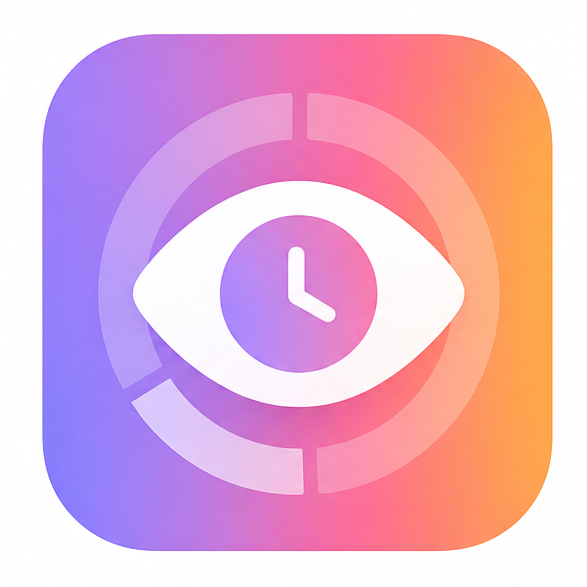

  

<h1 align="center">Loja de plugins e temas do Hindsight</h1>

  Explore plugins e temas, crie o seu plugin e envie-o para a loja.

  <a href="../zh/README.md">简体中文</a> · <a href="../zh-TW/README.md">繁體中文</a> · <a href="../../../README.md">English</a> · <a href="../ja/README.md">日本語</a> · <a href="README.md">Português</a> · <a href="../es/README.md">Español</a>

  
  

  <a href="#plugins">Ver plugins</a> · <a href="#criar-um-plugin">Criar um plugin</a> · <a href="#publicar-um-plugin">Publicar um plugin</a> · <a href="#temas">Temas</a>

---

A lista de plugins da loja de plugins do [Hindsight](https://github.com/Tomotsugu-dev/Hindsight). Sempre que o usuário abre Ajustes → Plugins, o Hindsight lê o [plugins.json](../../../plugins.json) e os ícones em [icons/](../../../icons/) da branch `main` deste repositório.

Este repositório também guarda o [themes.json](../../../themes.json), a lista de temas do [site de temas](https://hindsight.kyosweb.com/themes/).

## Plugins

| Ícone | Plugin | O que faz | Código |
|---|---|---|---|
|  | Focus | Cronometra seu trabalho no seu ritmo, avisa quando você se distrai e funciona com a ilha | [Tomotsugu-dev/hindsight-focus](https://github.com/Tomotsugu-dev/hindsight-focus) |

## Criar um plugin

A documentação para desenvolvedores está disponível em [inglês](../../en/getting-started.md) e [chinês simplificado](../../zh/getting-started.md):

- [Primeiros passos](../../en/getting-started.md): crie um plugin pequeno e instale-o a partir de um zip
- [Referência da API](../../en/api.md): campos do manifest, métodos, eventos e limites
- [Permissões](../../en/permissions.md): o que cada permissão permite, com qual outra ela deve ser pedida e o que o usuário vê na instalação
- [A ilha](../../en/island.md): o que um plugin pode mostrar na ilha da barra de menus do macOS, com uma página para cada componente

Os plugins exigem o Hindsight 0.10.0 ou posterior.

## Publicar um plugin

Plugins e novas versões entram na loja por pull request. Os passos, os campos do `plugins.json` e o que a revisão verifica estão em [CONTRIBUTING.md](../../../CONTRIBUTING.md) (em inglês).

## Temas

Um tema muda a aparência do Hindsight. No [site de temas](https://hindsight.kyosweb.com/themes/), você pode testar cada tema no navegador antes de baixá-lo. Descompacte o download e, no Hindsight, abra Ajustes → Aparência → Temas personalizados, clique em Importar tema e escolha `theme.json`.

- Como criar um tema: [Write a Hindsight theme](../../en/themes.md) (em inglês)
- Como publicar um tema: [Themes](../../../CONTRIBUTING.md#themes) no CONTRIBUTING.md (em inglês)

Os temas exigem o Hindsight 0.10.2 ou posterior.

## Plugins de terceiros

Qualquer pessoa pode enviar um plugin por pull request. Todo plugin é revisado antes de entrar na lista. Um plugin cujo repositório não está em `Tomotsugu-dev` é um plugin de terceiros: antes de instalá-lo, o usuário é avisado de que ele não é oficial e pode vazar informações pessoais.

<h2 align="center">Licença</h2>

  A lista de plugins deste repositório é publicada sob a <a href="../../../LICENSE">Licença MIT</a>. 
  Cada plugin é distribuído sob a licença do seu próprio repositório.

