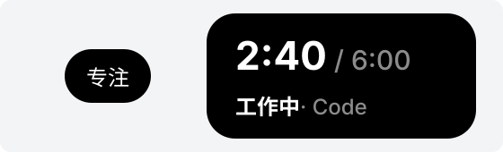

# text：一行字



左边是收起时的小字。右边是展开时：上面是大字加 `sub`，下面是分了段的小字。

```json
{ "type": "text", "text": "专注" }
```

```json
{ "type": "text", "text": [{ "text": "2:40", "bold": true }], "sub": "/ 6:00", "size": "large" }
```

```json
{ "type": "text", "text": [{ "text": "工作中", "bold": true }, { "text": " · Code", "dim": true }] }
```

| 字段 | 必须有吗 | 说明 |
|---|---|---|
| `text` | 是 | 一个字符串，或一列段 |
| `sub` | 否 | 跟在后面的灰色小字，只能是字符串 |
| `size` | 否 | `"small"`（默认）或 `"large"` |

每段是一个字符串，或者：

| 字段 | 必须有吗 | 说明 |
|---|---|---|
| `text` | 是 | 这段的字 |
| `color` | 否 | `#rrggbb` |
| `dim` | 否 | `true` 是灰色 |
| `bold` | 否 | `true` 是粗体 |

样式只有这三种，不能换字体和字号。

## 允许的放置位置

哪里都行。

| 位置 | 限制 |
|---|---|
| `closed.left`、`closed.right` | 只能是小字，不带 `sub` |
| `open.topRight`、`open.bottomRight` | 只能是小字 |
| `open.left`、`open.right` | 大字、小字都行 |

## 长度限制

文字按显示宽度算：全角字（汉字、假名、韩文、全角符号、emoji）算 2，其余每个字符算 1，几段合起来算。

| 哪里 | 上限 |
|---|---|
| 收起时 | 6 |
| 大字 | 8 |
| 大字后面的 `sub` | 14 |
| 小字和它的 `sub` 合起来 | 20 |

- 一列段不能是空的。每段的字和 `sub` 都不能是空的，也不能有换行这类控制字符：岛上的字只有一行。
