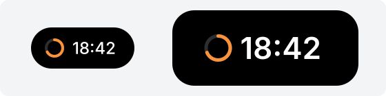

# timer：倒计时



左边是收起时，右边是展开时，都是过了四分之一的时候。环随时间变短，旁边是剩下的时间：一小时以上是 `h:mm:ss`，不到一小时是 `m:ss`。

```json
{ "type": "timer", "start": "2026-10-21T10:00:00+09:00", "end": "2026-10-21T10:25:00+09:00", "color": "#fb923c" }
```

| 字段 | 必须有吗 | 说明 |
|---|---|---|
| `start` | 是 | 开始的时间，RFC 3339，和 `focus.changed` 事件的 `at` 一样 |
| `end` | 是 | 结束的时间，格式同上 |
| `pausedAt` | 否 | 暂停的时间，格式同上。有它时，停在那一刻的剩余时间 |
| `color` | 否 | 环的颜色，`#rrggbb`，不给是白色 |

- Hindsight 自己倒数，插件不用每秒调一次 `island.show`。
- 暂停时再调一次 `island.show`，给计时器加上 `pausedAt`。
- 继续时，把 `start` 和 `end` 都往后挪暂停了多久，去掉 `pausedAt`，再调一次。只挪 `end` 的话，总时长变了，环就不准。
- 到 0 以后停在 0，等插件换内容。

## 允许的放置位置

| 位置 | 样子 |
|---|---|
| `closed.left`、`closed.right` | 14 像素的环，小字 |
| `open.left`、`open.right` | 20 像素的环，大字 |

## 取值限制

不合就报错：

- `start` 要早于 `end`。
- `pausedAt` 要在 `start` 和 `end` 之间。
